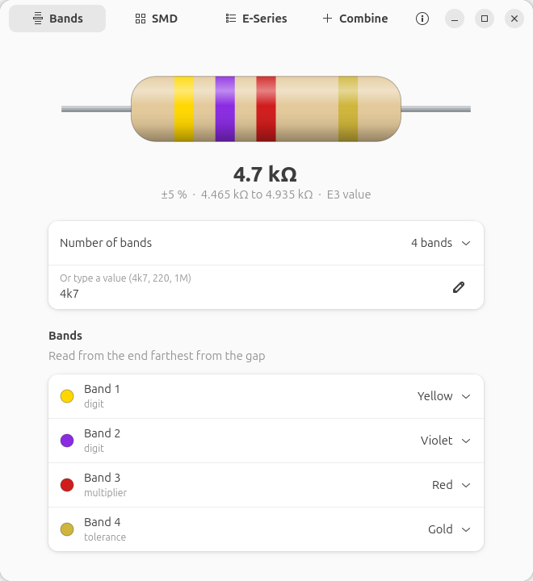
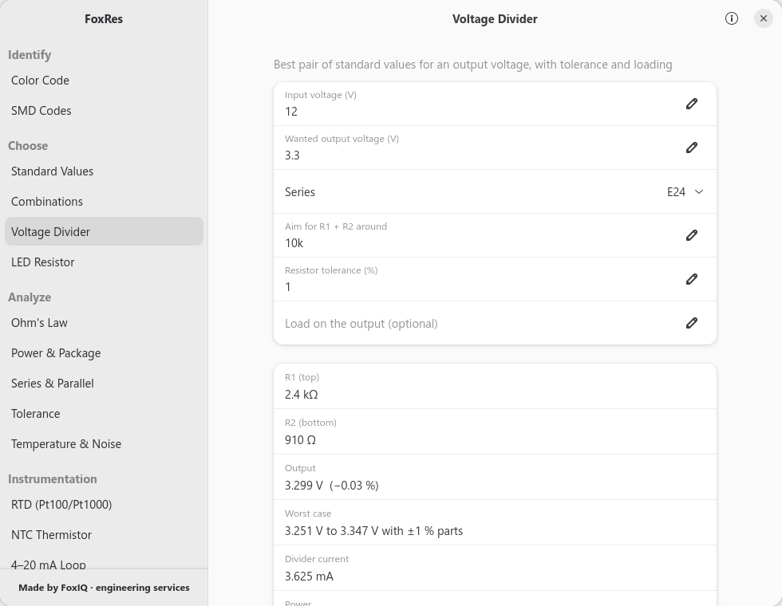
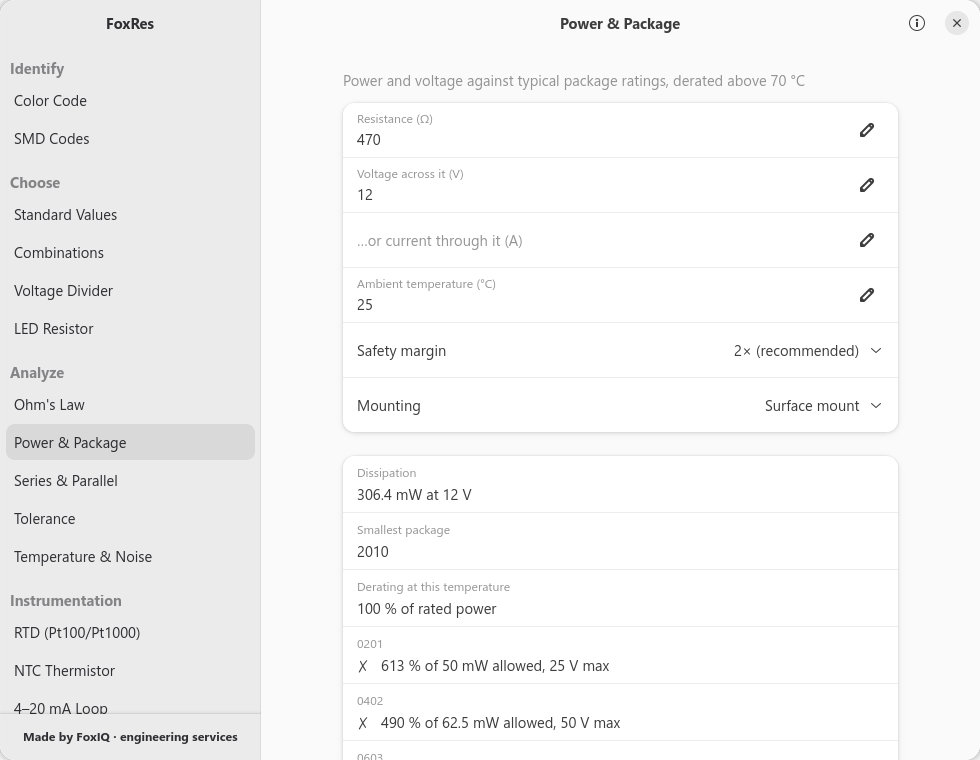
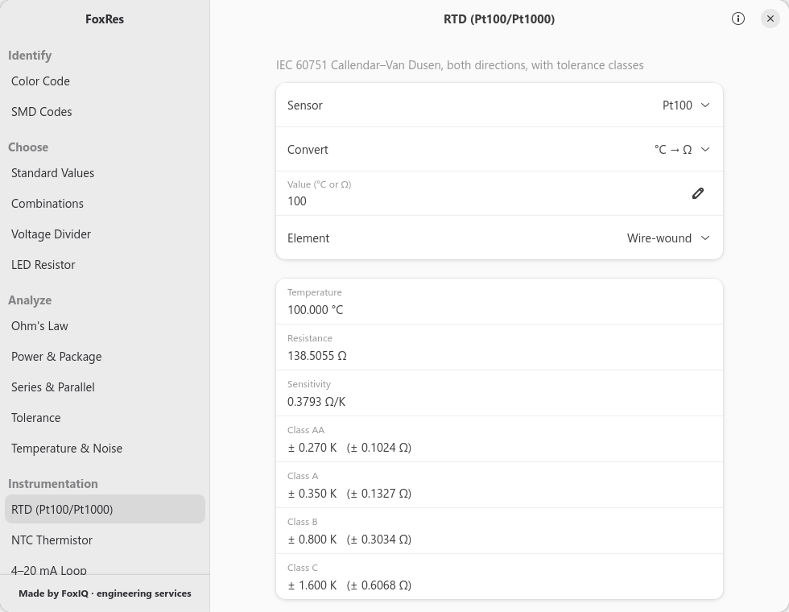
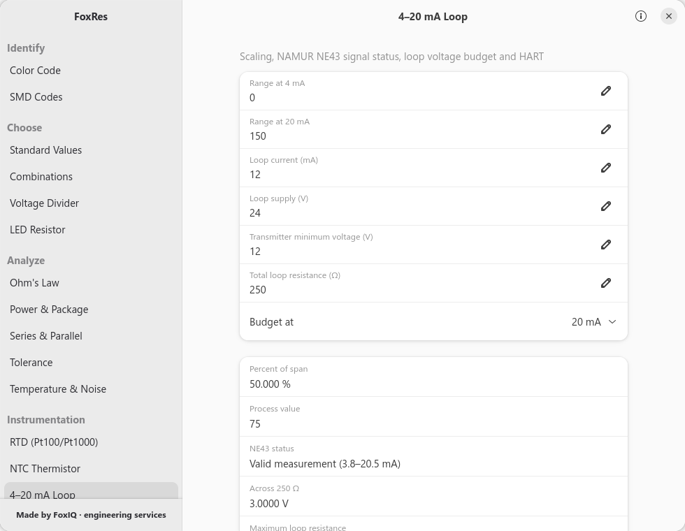

<div align="center">


# FoxRes

**The resistor toolkit, from color codes to 4–20 mA loops.**
A GNOME app and command-line tool, written in Rust. By [FoxIQ](https://www.foxiq.io).

[](https://snapcraft.io/foxres)



</div>

## Tools

| Identify | Choose | Analyze | Instrumentation & wiring |
|---|---|---|---|
| Color codes, 3–6 bands (IEC 60062), both ways | Nearest E3–E192 value (IEC 60063) | Ohm's law and power | Pt100/Pt1000 RTD (IEC 60751) with tolerance classes |
| SMD: 3-digit, 4-digit, R-notation, EIA-96 | Best two- and three-resistor combinations | Package power and voltage, with derating | NTC thermistor: Beta, Steinhart–Hart, 3-point fit |
| | Voltage divider with tolerance and loading | Series and parallel, any number | 4–20 mA: scaling, NAMUR NE43, loop budget, HART |
| | LED series resistor | Worst-case and RSS tolerance | Wheatstone bridge |
| | | Tempco drift and Johnson noise | Wire (AWG, mm²) and PCB trace (IPC-2221) |

Light and dark mode, keyboard navigation and screen-reader labels.

| Divider | Power | RTD | 4–20 mA |
|---|---|---|---|
|  |  |  |  |

## Command line

`foxres` with no arguments opens the window. With arguments it prints the answer and exits.
Every command takes `--json` for scripts, and `foxres <command> --help` explains its options.

```console
$ foxres bands yellow violet red gold
4.7 kΩ
Tolerance: ±5 % (4.465 kΩ to 4.935 kΩ)
Series: E3

$ foxres divider --vin 12 --vout 3.3 --load 100k
Target ratio:    0.275
Best pair:       R1 = 2.4 kΩ, R2 = 910 Ω (E24)
Ratio error:     -0.027 %
Vout:            3.299 V (worst case 3.251 V to 3.347 V)
Vout loaded:     3.277 V with 100 kΩ load (-0.655 %)

$ foxres combine 1234 -s E12
Series:   1.2 kΩ + 33 Ω = 1.233 kΩ (-0.08 %)
Parallel: 3.9 kΩ ∥ 1.8 kΩ = 1.232 kΩ (-0.20 %)
Three:    12 Ω + 22 Ω + 1.2 kΩ = 1.234 kΩ (+0.00 %)

$ foxres rtd --temp -40 --r0 1000
Pt1000: -40.000 °C ⇔ 842.7065 Ω
  Class A   ±0.230 K  (±0.9102 Ω)

$ foxres loop --value 75 --range 0:150 --supply 24 --tx-min 12
Current:             12.0000 mA
NE43:                Valid measurement (3.8–20.5 mA)
Max loop resistance: 600 Ω at 20 mA
HART:                ok (230–1100 Ω)
```

Commands: `bands`, `colors`, `smd`, `marking`, `nearest`, `combine`, `divider`, `led`, `ohm`,
`power`, `series`, `parallel`, `tolerance`, `drift`, `noise`, `rtd`, `ntc`, `loop`, `bridge`,
`wire`, `trace`. Values accept engineering notation: `4700`, `4.7k`, `4k7`, `100R`, `R47`, `2M2`,
`20m`, `4u7`.

## Correctness

The math lives in [`foxres-core`](crates/foxres-core), which has no dependencies.

- **Every** 3, 4, 5 and 6-band color combination (1,445,600 of them) decodes to the `f64` nearest the
  exact decimal value, bit for bit, and re-encodes to the same bands.
- **Every** 3-digit, 4-digit and EIA-96 SMD code (11,960) decodes exactly and re-encodes.
- **Every** E-series table is checked against the IEC 60063 formula `10^(i/n)`; the only departures
  allowed are the ones the standard itself makes.
- The divider, two- and three-resistor searches are checked against brute force over every
  combination.
- RTD conversions match the printed IEC 60751 Pt100 table and invert to 1e-9 K at every 0.1 °C
  from −200 to 850 °C; Steinhart–Hart fits and inverts exactly; AWG sizes and copper resistance
  match standard tables.
- Decimal scaling never multiplies by an inexact constant such as `0.001`.

Package power and voltage ratings are typical values for general-purpose parts; the datasheet
always wins.

## Install

```sh
sudo snap install foxres
```

## Build from source

```sh
# Command-line tool only, any platform:
cargo install --path crates/foxres-cli

# GNOME app (Ubuntu 24.04 or newer):
sudo apt install libgtk-4-dev libadwaita-1-dev
cargo run --release
```

The app targets the GNOME 46 API (GTK 4.14, libadwaita 1.5) so it runs in the `core24` snap
runtime. To regenerate the screenshots: `FOXRES_SCREENSHOTS=docs/screenshots cargo run --release`.

```
crates/foxres-core   resistor math, no dependencies, exhaustively tested
crates/foxres-cli    command-line interface
crates/foxres-gtk    GTK 4 + libadwaita app (Relm4); runs the CLI when given arguments
data/                desktop file, AppStream metainfo, icons, store artwork
snap/                snapcraft.yaml
```

## About

FoxRes is made by [FoxIQ](https://www.foxiq.io), instrumentation and controls engineering.
MIT licensed; see [LICENSE](LICENSE).
