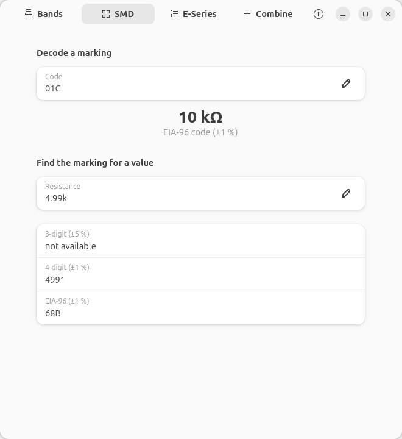
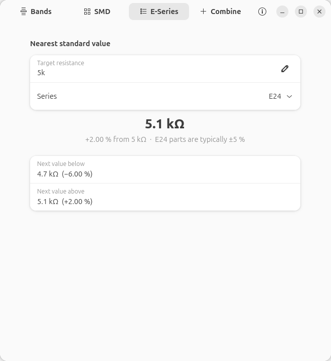
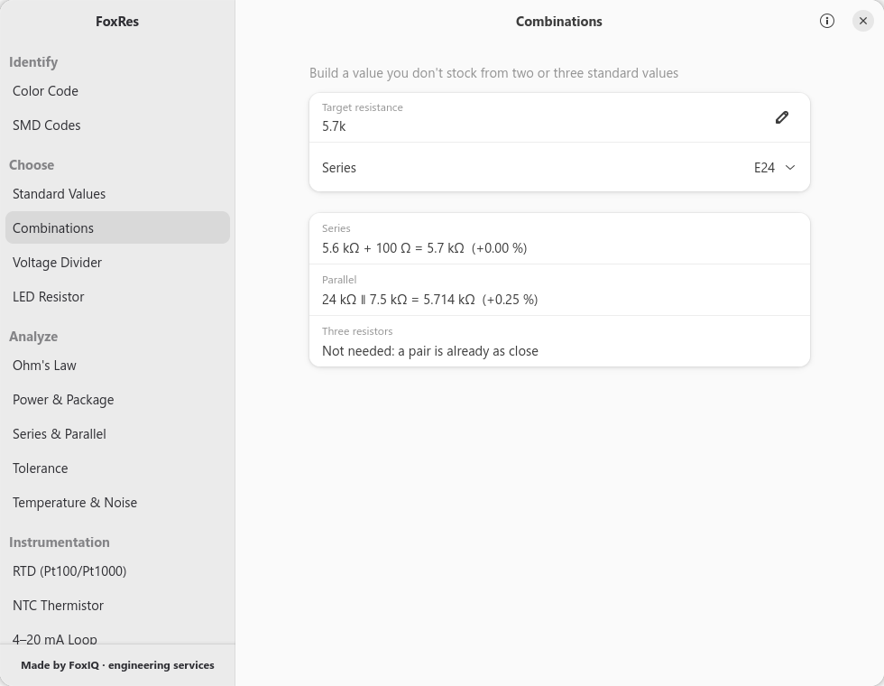
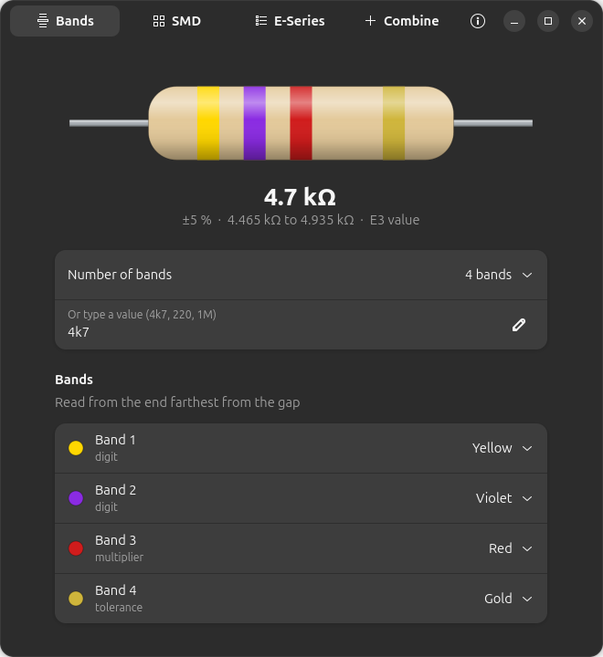

<div align="center">


# FoxRes

**Resistor color codes, SMD markings, E-series values and combinations.**
A GNOME app and command-line tool, written in Rust. By [FoxIQ](https://www.foxiq.io).


</div>

## Features

- **Bands**: decode 3, 4, 5 and 6-band resistors (IEC 60062, including pink, orange and yellow
  tolerances and the temperature-coefficient band), or type a value such as `4k7` and get its bands
- **SMD**: read and generate 3-digit, 4-digit, R-notation and EIA-96 markings
- **E-Series**: nearest E3 to E192 value (IEC 60063), with the values either side and the error
- **Combine**: the best series or parallel pair of standard values for a value you don't stock
- **Command line**: every calculation from a terminal or script, with `--json` output
- Light and dark mode, keyboard navigation, screen-reader labels

| SMD | E-Series | Combine | Dark |
|---|---|---|---|
|  |  |  |  |

## Command line

`foxres` with no arguments opens the window. With arguments it prints the answer and exits:

```console
$ foxres bands yellow violet red gold
4.7 kΩ
Tolerance: ±5 % (4.465 kΩ to 4.935 kΩ)
Series: E3

$ foxres colors 4.75k --bands 5
yellow violet green brown brown
4.75 kΩ ±1 %

$ foxres smd 01C
10 kΩ
Notation: EIA-96 code (±1 %)

$ foxres marking 4.99k
4.99 kΩ
3-digit: —
4-digit: 4991
EIA-96:  68B

$ foxres nearest 5k --series E96
E96 4.99 kΩ (-0.20 %)
Below: 4.99 kΩ (-0.20 %)
Above: 5.11 kΩ (+2.20 %)

$ foxres combine 5.7k --series E12 --json
{"parallel_pair":{...},"series":"E12","series_pair":{"a_ohms":5600.0,"b_ohms":100.0,"error_percent":0.0,"total_ohms":5700.0},"target_ohms":5700.0}
```

Values accept engineering notation: `4700`, `4.7k`, `4k7`, `100R`, `R47`, `2M2`, `2.2meg`,
`10m` (milliohms). `foxres --help` lists everything.

## Correctness

The math lives in [`foxres-core`](crates/foxres-core), which has no dependencies. Its tests are
exhaustive, not sampled:

- **Every** 3, 4, 5 and 6-band color combination (1,445,600 of them) decodes to the `f64` nearest
  the exact decimal value, bit for bit, and re-encodes to the same bands.
- **Every** 3-digit (1,000), 4-digit (10,000) and EIA-96 (960) SMD code decodes exactly and
  re-encodes.
- **Every** E-series table is checked against the IEC 60063 formula `10^(i/n)`. The only
  departures allowed are the ones the standard itself makes (27, 30, 33, 36, 39, 43, 47 and 82 in
  E24, and 920 in E192), so a typo anywhere fails the build.
- The nearest-value search is checked against every value in range, and the combination finder
  against a brute-force search of all pairs.

Decimal scaling never multiplies by an inexact constant such as `0.001`. Values are scaled by exact
powers of ten or parsed with the exponent attached, so `10m` is exactly the `f64` nearest 0.01 Ω.

## Install

[](https://snapcraft.io/foxres)

```sh
sudo snap install foxres
```

## Build from source

```sh
# Command-line tool only, any platform:
cargo install --path crates/foxres-cli

# GNOME app (Ubuntu 24.04 or newer):
sudo apt install libgtk-4-dev libadwaita-1-dev
cargo run --release
```

The app targets the GNOME 46 API (GTK 4.14, libadwaita 1.5) so it runs in the `core24` snap
runtime. To regenerate the screenshots: `FOXRES_SCREENSHOTS=docs/screenshots cargo run --release`.

```
crates/foxres-core   resistor math, no dependencies, exhaustively tested
crates/foxres-cli    command-line interface
crates/foxres-gtk    GTK 4 + libadwaita app (Relm4); runs the CLI when given arguments
data/                desktop file, AppStream metainfo, icon
snap/                snapcraft.yaml
```

## License

MIT. See [LICENSE](LICENSE).
